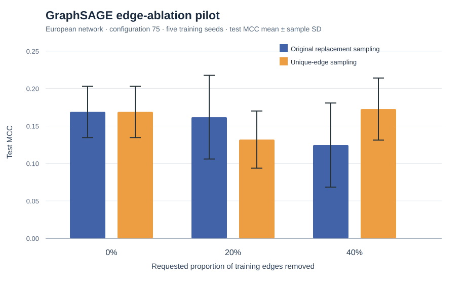
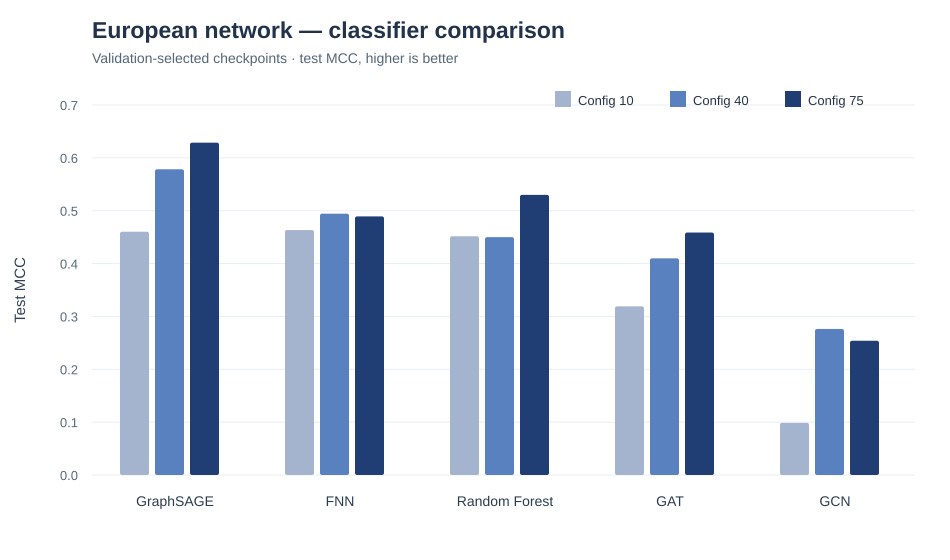

# Financial Systemic Risk GNN

**Reproduction & GraphSAGE Edge-Ablation Study**

[](https://github.com/Sungjincude/gnn-systemic-risk-portfolio/actions/workflows/check-results.yml)

A **portfolio research extension** of [*Predicting Systemic Risk in Financial Systems Using Deep Graph Learning*](https://doi.org/10.1016/j.iswa.2023.200240) (Balmaseda, Coronado & de Cadenas-Santiago, 2023). The original model architectures and data-processing pipeline belong to the original researchers; this repository is **not** the official implementation.

This companion repository records (1) a validation-selected comparison of graph and non-graph classifiers for the European banking network and (2) a controlled five-seed pilot evaluating the sensitivity of GraphSAGE to training-time edge removal.



## Key results

### Validation-selected model comparison

| Train / validation / test configuration | GraphSAGE test MCC | GraphSAGE test accuracy | Best observed test MCC |
|:--|--:|--:|:--|
| 10 — 8% / 2% / 90% | 0.460 | 59.42% | FNN: 0.463 |
| 40 — 32% / 8% / 60% | 0.578 | 68.28% | GraphSAGE: 0.578 |
| 75 — 60% / 15% / 25% | 0.629 | 72.10% | GraphSAGE: 0.629 |



Source: [`results/european_validation_selected_all.csv`](results/european_validation_selected_all.csv). Saved checkpoints were ranked using **validation MCC** rather than choosing a winner using test accuracy/MCC. These configurations use different labeled-data splits and should not be interpreted as a controlled causal comparison.

### GraphSAGE training-time edge-ablation pilot

Five training seeds (101, 202, 303, 404, 505), **one fixed data split** (seed 4444), and 40 epochs per run. Each cell reports mean test MCC ± standard deviation over seeds.

| Requested edge removal | Original sampling with replacement | Exact unique-edge removal |
|:--|--:|--:|
| 0% | 0.1689 ± 0.0343 | 0.1689 ± 0.0343 |
| 20% | 0.1618 ± 0.0559 | 0.1319 ± 0.0382 |
| 40% | 0.1246 ± 0.0561 | 0.1726 ± 0.0415 |

The original implementation used draws **with replacement**, so requesting 20% or 40% did *not* necessarily remove that fraction of **distinct** non-self-loop edges. Our corrected variant samples without replacement. A preflight diagnostic on 2,893 non-self-loop edges and 1,444 nodes confirmed removal of **578 distinct edges (20%)** and **1,157 distinct edges (40%)**, with exactly one self-loop per node retained. Percentages are rounded to whole-edge counts.

The best corrected mean at 40% removal exceeds the 0% baseline by **only 0.0037 MCC**, far less than the across-seed standard deviation. This is **not evidence of a reliable improvement**. The earlier single-seed pilot's apparent 20% advantage did not hold consistently across five training seeds.

This experiment studies **training-time random graph augmentation**, **not** physically deleting real banking connections or estimating a causal effect of bank failure.

## Original work vs. this extension

**Original researchers' work:** source banking-network generation, target definition, model classes, training infrastructure, and the base research question. See [original GitHub source](https://github.com/vibalcam/gnn-systemic-risk) and [paper](https://doi.org/10.1016/j.iswa.2023.200240).

**Work documented here:** notebook/environment repair for newer library versions, validation-MCC checkpoint evaluation, comparison across three data splits, identification of replacement-sampling behavior, distinct-edge sampling and preflight verification, repeated-seed pilot, and comparative visualization. Results are an exploratory replication/extension, not a newly invented GNN architecture.

This repository deliberately **does not redistribute** the original code or banking-network data. The original repository did not visibly provide an explicit code license when this portfolio package was prepared; its source should not be relicensed as one's own. The included **analysis notebook reads the published CSVs and does not need the upstream code**; only the original training experiments and the distinct-edge dataset extension require a separate checkout of the original implementation. This repository's new scripts and analysis files are distinct from that upstream code.

## Repository contents

- [`results/`](results) — full observed MCC/accuracy values (three configurations; two 5-seed pilot designs).
- [`figures/`](figures) — readable vector figures of both comparisons.
- [`scripts/plot_results.py`](scripts/plot_results.py) — regenerate the figures using the included summary CSVs.
- [`scripts/validate_results.py`](scripts/validate_results.py) — check the tabular completeness and consistency of the reported study.
- [`src/unique_edge_dataset.py`](src/unique_edge_dataset.py) — small original subclass for exact unique-edge removal, importing the upstream dataset class.
- [`notebooks/edge_ablation_analysis.ipynb`](notebooks/edge_ablation_analysis.ipynb) — a runnable notebook that independently computes summary statistics and plots from the recorded CSVs; it does **not** retrain GraphSAGE.
- [`METHODOLOGY.md`](METHODOLOGY.md) — evaluation protocol and limitations.

## Regenerate figures and validate the included results (no PyTorch needed)

Python 3.9+:

```bash
python -m venv .venv
source .venv/bin/activate
python -m pip install -r requirements.txt
python scripts/validate_results.py
python scripts/plot_results.py
```

## Explore the results in Jupyter (no training required)

Run `jupyter lab` with the lightweight dependencies above and open [`notebooks/edge_ablation_analysis.ipynb`](notebooks/edge_ablation_analysis.ipynb). This notebook reads the included CSVs, checks their completeness, calculates across-seed mean and sample SD, and plots comparisons. Jupyter itself may need to be installed separately (`python -m pip install jupyterlab`).

## Reproduce model training (requires the original research implementation)

The recorded results originated from experiments run in a separate local checkout of [the original repository](https://github.com/vibalcam/gnn-systemic-risk). The upstream implementation, banking-network data, and saved model checkpoints are **not included** in this portfolio. The [unique-edge sampling extension](src/unique_edge_dataset.py) imports the original `models.utils.ContagionDataset` class; it therefore requires the upstream code and a compatible PyTorch/DGL environment. See [METHODOLOGY.md](METHODOLOGY.md) for the experiment design.

**Scope:** The analysis notebook and plotting/validation scripts are reproducible from the files here, but the full training runs cannot be reproduced from this repository alone. They have not been rerun as part of publishing this GitHub companion.

## Important limitations

- All five pilot training seeds shared a **single train/validation/test split**.
- The evaluation uses a **transductive graph**: validation and test node features and graph connectivity may be present during message passing, but their labels are not included in the training loss. Feature provenance and broader leakage risks have not been independently audited.
- The pilot uses **GraphSAGE mean aggregation with two 32-unit hidden layers**, 40 epochs, and is **not the stronger original benchmark model**; its MCC should not be compared directly with the benchmark's 0.629 test MCC as if the setup were equal.
- Selecting a preferred removal rate after examining test scores would introduce test-set selection bias. Report all conditions; treat comparisons as exploratory.
- Numerical differences are not claims of statistical significance, economic causality, or production suitability.
- Training results depend on environment and random number generation.

## Citation and attribution

If using the original system, cite:

> Balmaseda, V., Coronado, M., & de Cadenas-Santiago, G. (2023). *Predicting systemic risk in financial systems using Deep Graph Learning*. **Intelligent Systems with Applications, 19**, 200240. https://doi.org/10.1016/j.iswa.2023.200240

Original implementation: https://github.com/vibalcam/gnn-systemic-risk

**Educational / research portfolio. Not financial advice.**